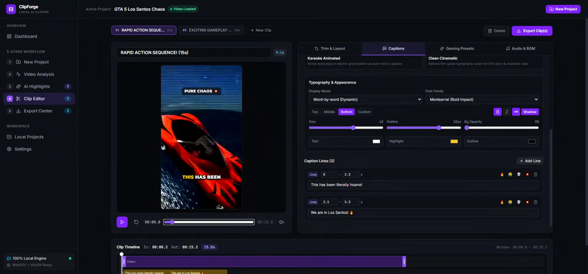
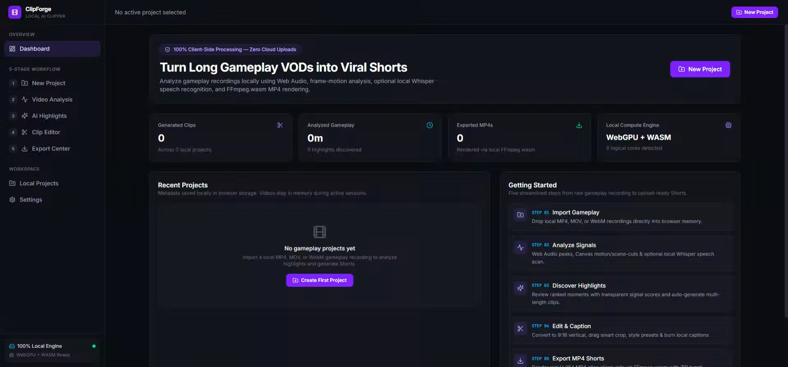
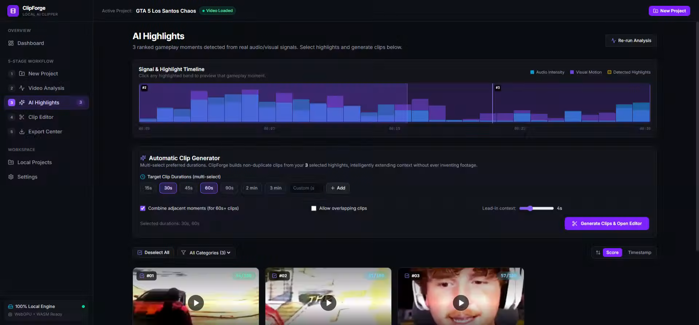
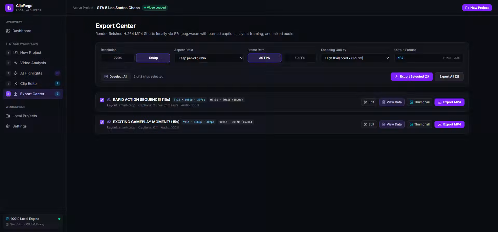
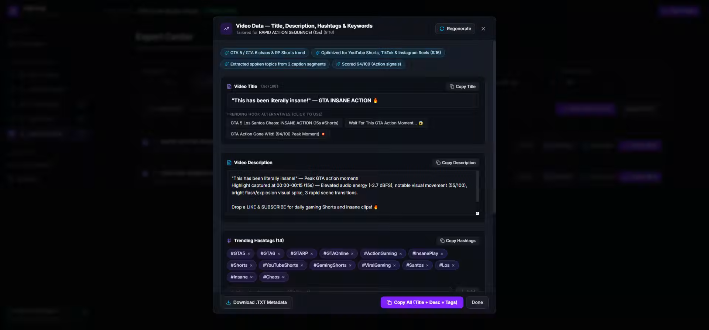
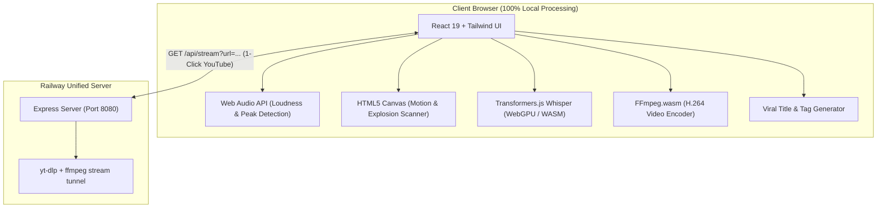

# ClipForge — Local AI Gaming Video Clipper & Shorts Studio

<div align="center">



[](https://clipforge-production-1b2a5d93.up.railway.app/)
[](https://clipforge-pi-ecru.vercel.app/)
[](LICENSE)
[](https://react.dev/)
[](https://www.typescriptlang.org/)
[](https://tailwindcss.com/)
[](https://ffmpegwasm.netlify.app/)
[](https://huggingface.co/docs/transformers.js)

**Turn full-length gameplay recordings into viral 9:16 vertical YouTube Shorts, TikToks & Instagram Reels directly in your browser.**

[🚀 Open Live App (Railway)](https://clipforge-production-1b2a5d93.up.railway.app/) • [⚡ Mirror (Vercel)](https://clipforge-pi-ecru.vercel.app/)

</div>

---

## 🌟 Key Features

- **⚡ 1-Click YouTube Streaming & Clipping**: Paste any YouTube link (watch, youtu.be, /shorts, /live) to stream and clip directly without downloading giant files.
- **🎙️ 100% Local Whisper AI Auto-Captions**: In-browser speech recognition via Transformers.js Whisper (runs on `WebGPU` with `CPU WASM` fallback). Zero external API keys needed!
- **🎮 AI Gameplay Highlight Detection**: Web Audio loudness/onset scanning + Canvas motion, explosion, and scene-cut detection tuned across 10 gaming categories (GTA, Fortnite, Call of Duty, Valorant, Minecraft, etc.).
- **📐 Smart 9:16 Vertical Video Studio**: Instant conversion from 16:9 landscape to 9:16 vertical with 5 layouts (`Smart Crop`, `Blurred Background`, `Center Crop`, `Stacked Facecam`, `Full Gameplay`).
- **🎨 6 Viral Caption Presets**: MrBeast Bold, Gaming Neon, Yellow Keywords, Karaoke Animated, Minimal Clean, and Cinematic with live word-by-word timing adjustments.
- **📦 In-Browser MP4 & ZIP Export**: Real client-side H.264/AAC video encoding via FFmpeg.wasm (`720p` / `1080p`, `30` / `60 FPS`), batch rendering, and downloadable `.zip` bundles.
- **🏷️ View Data SEO Metadata Pack**: Auto-generates platform-ready video titles, trending hook alternatives, descriptions, and hashtags with 1-click clipboard copy.

---

## 📸 Screenshots & Walkthrough

### 1. Project Dashboard & Video Import
Import gameplay recordings via **Local File Upload** (MP4, MOV, WebM), **1-Click YouTube Stream**, or **Direct CORS URL**.



---

### 2. AI Gameplay Signal & Highlight Detection
Real-time audio loudness waveforms, visual motion spikes, and ranked action highlights detected automatically.



---

### 3. Smart 9:16 Clip Editor & Live Captions
Vertical framing, draggable manual crop regions, audio mixing, and word-by-word Whisper subtitle timing.


---

### 4. Export Center & Batch H.264 MP4 Rendering
Client-side FFmpeg rendering at 720p/1080p 60fps, thumbnail generation, and bulk ZIP exports.



---

### 5. View Data SEO & Metadata Generator
Platform-optimized titles, hooks, viral hashtags, and search tags for YouTube Shorts and TikTok.



---

## 🏗️ Architecture



---

## 🚀 Getting Started

### Prerequisites

- Node.js 20+
- npm or yarn

### Installation

```bash
# Clone the repository
git clone https://github.com/hashirmeraj/clipforge.git
cd clipforge

# Install dependencies
npm install

# Start local development server
npm run dev
```

Visit `http://localhost:5173` to start clipping gameplay recordings!

### Build for Production

```bash
npm run build
```

### Start Unified Production Server (Frontend + YouTube Stream API)

```bash
npm start
```

---

## 🚢 Deployment

### Deploy to Railway (Recommended)

ClipForge is pre-configured for **Railway** with `Dockerfile` and `nixpacks.toml`:

[](https://railway.com/)

1. Create a project on Railway and select **Deploy from GitHub repo**.
2. Select `hashirmeraj/clipforge`.
3. In service settings, generate a domain under **Networking**.

### Deploy to Vercel

ClipForge also supports zero-config static deployment on Vercel:

[](https://vercel.com/new/clone?repository-url=https://github.com/hashirmeraj/clipforge)

---

## 📄 License

This project is licensed under the [MIT License](LICENSE).
